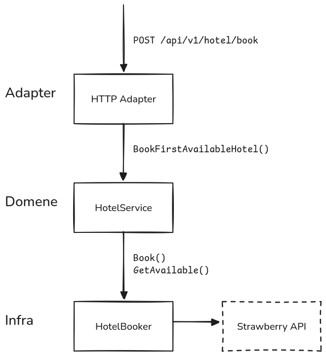

# Domain Driven Design for Dummies

## Setup

```sh
# Klone
git clone https://github.com/echo-webkom/ddd-for-dummies.git
cd ddd-for-dummies

# Skjekke at Go funker
go run cmd/main.go
```

## Hva er Domain Driven Design?

Domain Driven Design (DDD) er en slags arkitektur/paradigme. Det går ut på å dele opp applikasjonen din i tre hoveddeler; domene, infrastruktur, og adaptere. DDD er veldig godt egnet for store applikasjoner ettersom det gjør ting lett å vedlikeholde, oppdatere, og utvikle.

Appen er delt opp i tre hoveddeler:

- Adapter
- Domene
- Infrastruktur

### Domene

Domenet er kjernen av applikasjonen. Du kan tenke på det som en komponist, du vet hvordan musikken skal høres ut, og du er ansvarlig for å deligere ulike deler av stykket til de som spiller instrumentene. Du kan ikke spille noen instrumenter selv, og du vet ikke hvem som spiller dem.

Et mer relevant eksempel kan være en reisebooking-app. Domenet vil inneholde koden som tar inn nye bookinger. Den er avhengig av ulike tjenster for å skjekke om hoteller er ledig, booke fly, beregne budsjetter, osv.

Domenet definerer ulike `ports`. Dette er bare et `interface` som sier hvordan tjenestene den bruker skal se ut:

```go
// Fil /domain/port/hotel.go
package port

// Sier hvilke metoder som domenet trenger for å fikse booking.
// Bryr seg ikke om hvordan dette faktisk er implementert.
type HotelBooker interface {
	GetAvailable() ([]Hotel, error)
	Book(hotelID string) error
}
```

```go
// Fil /domain/model/hotel.go
package model

type Hotel struct {
	ID 	  string
	Name  string
	Price int
	// ...
}
```

```go
// Fil /domain/service/hotel.go
package service

// HotelService håndterer all 'domenelogikk' relatert til hoteller.
type HotelService struct {
	booker port.HotelBooker
}

func (h *HotelService) BookFirstAvailableHotel(booker port.HotelBooker) (hotel Hotel, err error) {
	hotels, err := h.GetAvailable()
	if err != nil {
		return hotel, err
	}

	if len(hotels) == 0 {
		return hotel, errors.New("no available hotels")
	}

	firstHotel := hotels[0]
	if err := h.booker.Book(firstHotel.ID); err != nil {
		return hotel, err
	}

	return firstHotel, nil
}
```

### Infrastruktur

Dette er laget som faktisk implementerer `ports` definert av domenet. I eksempelet vårt med en booking-app vil infrastruktur laget implementere `HotelBooker`.

```go
// Fil /infra/strawberry/hotel.go
// Her er 'strawberry' strawberry.no
package strawberry

type hotelBooker struct {
	// Denne implementasjonen bruker Strawberry sitt api for å gjøre ting.
	api *strawberry.ApiClient
}

func (h *hotelBooker) GetAvailable() ([]port.Hotel, error) {
	// ...
}

func (h *hotelBooker) Book(id string) (error) {
	// ...
}
```

Nå kan du begynne å se fordelene med DDD. Om vi i fremtiden velger å gå vekk fra Strawberry og heller vil bruke Hotels.com eller vår egen tjeneste vil det bare kreve å implementere `HotelBooker` interfacet. Utenom det vil resten av appen funke som før.

På denne måten skiller DDD implementasjon og logikk. Appen bryr seg ikke hvilken underliggende tjeneste som brukes for å hente/booke hoteller, den vet bare hvilke metoder den trenger, og opererer på disse.

### Adapter

Så var er da adapter laget? Det er egentlig veldig enkelt; det er koden som kaller på domenelogikk.

Grunnen til at det er et eget lag er fordi du kan ha flere adaptere for samme app (flere måter å bruke samme domenelogikk på). Booking-appen vår kan for eksempel være et API, GUI, TUI, eller noe helt annet. En adapter er bare måten du interagerer med koden på.

For booking-appen vår lager vi et enkelt API:

```go
// Fil /adapter/http/hotel.go
package http

type hotelMux struct {
	hotelService *service.HotelService
}

// Denne funksjonen er mountet til å svare på endepunktet POST /api/v1/hotel/book.
func (h *hotelMux) handleHotelBooking(request *http.Request, response http.ResponseWriter) error {
	auth, err := getAuth(request)
	if err != nil {
		return err
	}

	hotel, err := h.hotelService.BookFirstAvailableHotel()
	if err != nil {
		return err
	}

	return writeJsonResponse(hotel, response)
}
```

### Diagram

Diagram av eksempelet som har blitt gått gjennom:



## Struktur

Dette er mappestrukturen til eksempelet:

```
/adapter
  /http
    hotel.go
/domain
  /port
    hotel.go
  /model
    hotel.go
  /service
    hotel.go
/infra
  /strawberry
    hotel.go
```

## Oppgave

Du kan gå videre til [denne oppgaven](./OPPGAVE.md) for å implementere et liknende API fra bunnen av.
